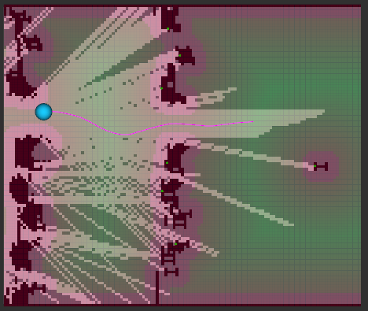

# Nimbus: Real-Time Mapping and CEM-MPC Navigation

An autonomous navigation stack for a Flappy-Bird-inspired 2D environment. The
controller builds a local map from sparse laser scans, computes obstacle
clearance, and uses Cross-Entropy Method model-predictive control (CEM-MPC) to
select acceleration commands at 30 Hz.



## Highlights

- ROS 2 integration with a real-time game environment
- Rolling local occupancy grid with deterministic laser-ray integration
- Exact Euclidean distance field and conservative obstacle inflation
- Receding-horizon CEM-MPC with warm starts, hard collision checks, and a
  bounded planning budget
- RViz visualisation of mapping, clearance, state, and planned trajectory
- Unit tests, benchmarks, and a reproducible objective-weight experiment
  harness

## Repository layout

```text
nimbus_main_game/          ROS 2 game environment and laser sensor
nimbus_autonomy_code_cpp/  C++ mapping, planning, visualisation, and tests
Dockerfile                  Optional Ubuntu 24.04 / ROS 2 Jazzy environment
```

The autonomy implementation and its documentation live in
[`nimbus_autonomy_code_cpp/`](nimbus_autonomy_code_cpp/). See its
[README](nimbus_autonomy_code_cpp/README.md) for build, execution, RViz,
experiments, and formatting commands. See the
[algorithmic overview](nimbus_autonomy_code_cpp/docs/README.md) for the design
of the mapper and planner.

## Quick start

The project targets Ubuntu 24.04, ROS 2 Jazzy, and Python 3.12. After sourcing
ROS 2 and creating a virtual environment with system site packages, install the
game environment:

```bash
source /opt/ros/jazzy/setup.bash
python3 -m venv .venv --system-site-packages
source .venv/bin/activate
python3 -m pip install ./nimbus_main_game
```

Build the autonomy node:

```bash
cd nimbus_autonomy_code_cpp
cmake --preset release
cmake --build --preset release
```

Run the game, RViz, and the autonomy node in separate terminals as described in
the [autonomy README](nimbus_autonomy_code_cpp/README.md#run).
