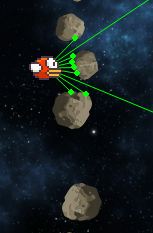
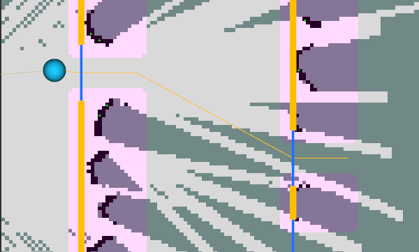

# Algorithms and design

This document describes the principal algorithmic choices in the mapping and
planning stack. It focuses on the parts that materially affect navigation
behaviour rather than providing an exhaustive API reference.

## Solution Overview

Nimbus is treated as a partially observed, real-time navigation problem.
The system therefore uses a local, receding-horizon pipeline:

```text
velocity + laser scan -> integrated pose
                      -> local occupancy map
                      -> clearance / inflated collision map
                      -> CEM trajectory optimisation
                      -> first acceleration
```

The ROS adapter in [`nimbus_ros.cpp`](../src/nimbus/nimbus_ros.cpp) integrates
the received velocity to the scan timestamp, updates the map, plans, publishes
visualisation messages, and sends only the first control from the chosen plan.

The environment provides noise-free laser and velocity measurements. The stack
therefore dead-reckons pose by integrating velocity, an assumption that is
appropriate for this controlled simulation but would need replacing with state
estimation on a physical system.

## Local occupancy map

[`RollingOccupancyGrid`](../src/nimbus/occupancy_grid.hpp) is a world-aligned
occupancy grid with 3.5 cm square cells. It is local rather than global because
the game continually moves forward and the controller only needs nearby pipes.

- Horizontally, the map is a circular rolling buffer: `0.5 m` is retained behind
  the bird and the remaining `4.0 m` lies ahead. Advancing the map clears only
  the entering columns rather than copying the full grid. The rolling buffer is
  an allocation-avoiding optimisation; the distance transform and map inflation
  still scan the full grid, so map processing remains `O(HW)`.
- Vertically, the map is fixed to the playable game range, from the floor at
  `-1.3548m` to the ceiling at `2.44 m`. The floor and ceiling rows are injected
  as obstacles on every update, so the planner cannot leave the world.
- A cell has a direct state: unknown, free, or occupied. There is deliberately
  no probabilistic log-odds filter because the game's laser is deterministic.
  A new scan directly replaces traversed cells with free space and hit cells
  with obstacles.

### Laser integration and Bresenham traversal

A scan provides an angle and range in continuous coordinates, while the map is
discrete. For each ray, Bresenham's line algorithm visits the cells between the
bird and the measured endpoint:

- every visited interior cell is marked free, because the ray reached beyond it;
- a max-range ray also marks its endpoint free;
- a hit ray marks its endpoint occupied instead.

This free-space update is essential even with deterministic measurements: it
clears stale cells as the rolling map is observed from new poses. Bresenham is
a good fit because it is allocation-free and costs only one operation per grid
cell crossed by a ray.

### Conservative pipe representation

The nine beams do not always observe every part of a pipe edge. The map adds a
small, explicit safety prior to each hit: four cells ahead and one cell above
and below are marked occupied. For a newly observed hit, it also looks three
cells left and up to 0.40 m above and below. If it finds another raw obstacle,
it fills the short vertical gap between them. This joins incomplete observations
of a single pipe without treating arbitrary free space as a pipe.

These modifications encode an empirical safety margin. Four cells ahead of a
hit guard against rapid altitude changes immediately after a pipe, where the
limited simulated LiDAR field of view has not yet revealed the full obstacle.


The short vertical search to the left of a hit bridges obstacle fragments that
are too close to be navigable gaps. This makes the observed pipe structure more
conservative and prevents the optimiser from committing to a path that closes
too late to escape.



## Clearance and collision layers

The raw occupancy map is useful for visualisation, but planning needs two
derived representations.

### Exact Euclidean distance field

[`DistanceField`](../src/nimbus/distance_field.hpp) stores, for each grid cell,
the distance to the nearest raw obstacle. It implements the exact squared
Euclidean distance transform of Felzenszwalb and Huttenlocher, *[Distance
Transforms of Sampled Functions](https://theoryofcomputing.org/articles/v008a019/)*
(2012). The transform processes every row and then every column; each
one-dimensional pass constructs the lower envelope of parabolas. This makes
the full two-dimensional transform linear in the number of map cells, `O(W H)`.


Afterwards, a clearance query during a rollout is constant time instead of
searching all obstacle cells. That clearance provides a continuous preference
for the middle of a gap, even though collision itself is discrete.

The combined RViz view shows the raw laser evidence, conservative obstacle
layer, distance field, bird pose, and selected trajectory together:


### Inflated collision map

Raw obstacles are expanded by the bird safety radius (0.115 m), cell geometry,
and one extra conservative cell. The resulting inflated map represents places
the bird centre must not enter.

Every predicted motion segment is rasterised through this inflated map with
Bresenham traversal. Checking the whole segment prevents collision tunnelling:
the bird cannot jump over a thin occupied cell between two 30 Hz prediction
states.

## Motion model

The planner uses [`MotionModel`](../src/nimbus/planning/motion_model.hpp), which
encodes the same motion model that the game uses.
For timestep \(\Delta t = 1/30\) seconds:

\[
\begin{aligned}
v_{x,k+1} &= \operatorname{clip}(v_{x,k} + a_{x,k}\Delta t, 0, v_{\max}), \\
v_{y,k+1} &= \operatorname{clip}(v_{y,k} + a_{y,k}\Delta t, -v_{\max}, v_{\max}), \\
x_{k+1} &= x_k + v_{x,k+1}\Delta t, \\
y_{k+1} &= y_k + v_{y,k+1}\Delta t.
\end{aligned}
\]

The game acceleration limits are 3 m/s² horizontally and 35 m/s² vertically.
Although the physical game velocity cap is 10 m/s, the current autonomy cap is
2 m/s to retain manoeuvring margin while mapping and planning. Controls are
limited predictively, so the next state cannot exceed that autonomy cap.

The `2 m/s` cap was selected empirically to preserve manoeuvring margin for
mapping and planning. Raising it is a natural direction for future work, but it
requires correspondingly earlier perception and more aggressive manoeuvres.

## CEM model-predictive control

[`CemMpcPlanner`](../src/nimbus/planning/cem_mpc_planner.hpp) is the default
planner. It uses the Cross-Entropy Method (CEM), a derivative-free optimiser
well suited to the non-convex obstacle constraints produced by pipe geometry.

At each scan, CEM optimises a 40-step sequence of two-dimensional accelerations:

\[
U = [(a_{x,0}, a_{y,0}), \ldots, (a_{x,39}, a_{y,39})].
\]

It performs three sample/refit iterations. In each iteration it draws 400
bounded control sequences from a time-indexed Gaussian, simulates all of them,
scores them, and refits the Gaussian from the best 50 candidates (called elites).
When feasible candidates exist, only they are allowed to become elites.

Only the first control of the best sequence is executed. The fitted Gaussian is
then shifted forward by one step to warm-start the next call. This is standard
receding-horizon MPC: replan with new sensing every frame rather than committing
to a long open-loop sequence. Sampling stops when the 20 ms real-time budget is
exhausted. This protects the 30 Hz control loop on a more constrained system.

The Gaussian distributions are warm-started: rather than restart without
information at each control cycle, the planner shifts the previous fitted
distribution forward and uses it as the next prior.

### Trajectory objective

[`TrajectoryObjective`](../src/nimbus/planning/trajectory_objective.hpp) ranks candidate trajectories. Lower cost is better.
In simplified form:

\[
\begin{aligned}
J ={}& -w_p (x_N - x_0)
 + \sum_k \frac{w_c}{\max(d_k, d_{\mathrm{min}})^2}
 + \sum_k w_v v_{y,k}^2 \\
&+ \sum_k w_u \lVert \bar{a}_k \rVert^2
 + \sum_k w_r \lVert \bar{a}_k - \bar{a}_{k-1} \rVert^2
 + J_{\mathrm{collision}}.
\end{aligned}
\]

The terms respectively reward forward progress, prefer clearance, discourage
unnecessary vertical speed, discourage large controls, and discourage abrupt
control changes. Accelerations are normalised by their axis limits before the
last two penalties, so horizontal and vertical commands are comparable. A
collision carries a dominant penalty, with an extra cost for collisions earlier
in the horizon.

The objective weights balance smoothness, clearance, and progress. The
[experiment harness](../tools/README.md) automates structured sweeps of this
parameter space and records their outcomes.

### Exceptional cases

If the current pose is legal but CEM finds no feasible trajectory, the planner
returns a deterministic emergency-braking sequence, which applies maximum
horizontal braking and vertical acceleration that drives `vy` towards zero.
This can create time to recover when the bird is headed towards a wall.

If however the pose is already in the conservative inflated layer but not in a
raw obstacle or beyond the map, the motion model allows a short escape from
inflation and returns CEM's least-cost recovery candidate. Raw obstacles and
world boundaries remain hard constraints during this recovery.

## Architecture and alternatives

[`Nimbus`](../src/nimbus/nimbus.hpp) owns a planner through the common
[`Planner`](../src/nimbus/planning/planner.hpp) interface; the ROS adapter does
not depend on a concrete planner. The factory currently exposes CEM MPC and a
Random Shooting baseline. Random Shooting is useful for validating map and
motion-model integration, but CEM is the shipped planner.

The design intentionally does not use linear/QP MPC. The kinematic dynamics are
linear, but collision avoidance in a measured occupancy grid is non-convex.
CEM avoids deriving gradients through discrete collision checks while retaining
the feedback and safety benefits of short-horizon MPC.

## Performance

The current shipping benchmark snapshot is in
[`../BENCHMARKS.md`](../BENCHMARKS.md). It records the exact used parameters,
machine, and reproducible commands.

## Future work

Potential extensions include reinforcement learning and evolutionary policies,
nonlinear MPC or timed-elastic-band local planning, and a global planner built
on explicitly modelled pipe gaps. A prototype that grouped obstacles into
semantic pillars made planning more expressive, but its added complexity did not
provide a sufficient benefit for the current local-control task.


